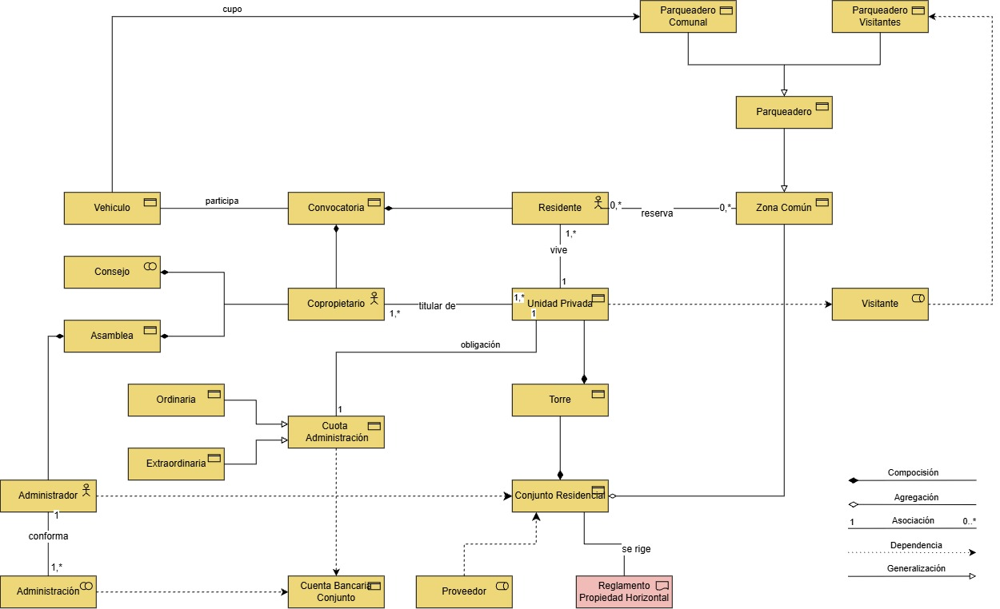

# Modelo semántico

> **Propósito:** fijar los conceptos del dominio de propiedad horizontal y sus relaciones, como vocabulario común para casos de uso, EUV y modelo de datos.
> **Fuente:** diagrama *Modelo Semántico v3*.

## Conceptos y relaciones
> ⚠️ **Por confirmar:** lectura del diagrama; validar con el rol de Negocio.

| Concepto | Relaciones en el modelo |
|----------|-------------------------|
| Conjunto Residencial | Se compone de Torres; agrega Zonas Comunes; se rige por el Reglamento de Propiedad Horizontal |
| Torre | Se compone de Unidades Privadas |
| Unidad Privada | Tiene Copropietarios titulares (1..\*) y Residentes que la habitan (1..\*); genera la obligación de Cuota de Administración; recibe Visitantes |
| Copropietario | Titular de Unidades Privadas; participa en Asamblea y Consejo; participa en Convocatorias |
| Residente | Vive en una Unidad Privada; reserva Zonas Comunes (0..\*); participa en Convocatorias |
| Convocatoria | Agrupa la participación de Residentes, Copropietarios y Vehículos |
| Vehículo | Participa en Convocatorias; obtiene cupo en Parqueadero Comunal |
| Zona Común | Generalización de Parqueadero; reservada por Residentes |
| Parqueadero | Generalización de Parqueadero Comunal y Parqueadero de Visitantes |
| Visitante | Depende de la Unidad Privada que visita; usa el Parqueadero de Visitantes |
| Cuota de Administración | Especializada en Ordinaria y Extraordinaria; se consigna en la Cuenta Bancaria del Conjunto |
| Administrador | Conforma la Administración; se relaciona con la Asamblea; administra el Conjunto Residencial |
| Administración | Gestiona la Cuenta Bancaria del Conjunto |
| Proveedor | Presta servicios al Conjunto Residencial |
| Reglamento de Propiedad Horizontal | Rige al Conjunto Residencial |

## Alineación de términos con la implementación
**Decisión:** la documentación de negocio usa los términos del modelo semántico; el código conserva sus nombres y la equivalencia se registra en el [glosario](../00-proyecto/04-glosario.md).

| Término del modelo | Término en la implementación v1 | Decisión |
|--------------------|---------------------------------|----------|
| Solicitud | Postulación (`Application`) | Se usa **Solicitud** en negocio |
| Unidad Privada | Apartamento (`Apartment`) | Se usa **Unidad Privada** en negocio |
| Convocatoria | Convocatoria (`Call` / `Convocation`) | Alineado |
| Torre | Torre (`Tower`) | Alineado |
