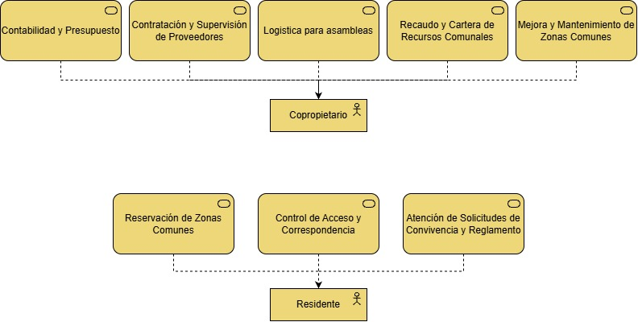

# Servicios de negocio

> **Propósito:** identificar el valor que el conjunto residencial entrega a cada actor de negocio.
> **Fuente:** diagrama *Servicios v2*. Plantilla: [servicio-de-negocio](../plantillas/servicio-de-negocio.md).

## Catálogo
| ID | Servicio de negocio | Actor de negocio | Escenarios de servicio | Alcance v1 |
|----|---------------------|------------------|------------------------|------------|
| SN-01 | Contabilidad y presupuesto | Copropietario | — | Fuera de v1 |
| SN-02 | Contratación y supervisión de proveedores | Copropietario | — | Fuera de v1 |
| SN-03 | Logística para asambleas | Copropietario | — | Fuera de v1 |
| SN-04 | Recaudo y cartera de recursos comunales | Copropietario | — | Fuera de v1 |
| SN-05 | Mejora y mantenimiento de zonas comunes | Copropietario | — | Fuera de v1 |
| SN-06 | Reservación de zonas comunes | Residente | [ESN-01](06-escenarios-de-servicio.md#esn-01--reserva-de-parqueadero-comunal), [ESN-02](06-escenarios-de-servicio.md#esn-02--reserva-de-zona-social) | 🟡 En construcción (ESN-01) |
| SN-07 | Control de acceso y correspondencia | Residente | — | Fuera de v1 |
| SN-08 | Atención de solicitudes de convivencia y reglamento | Residente | — | Fuera de v1 |
