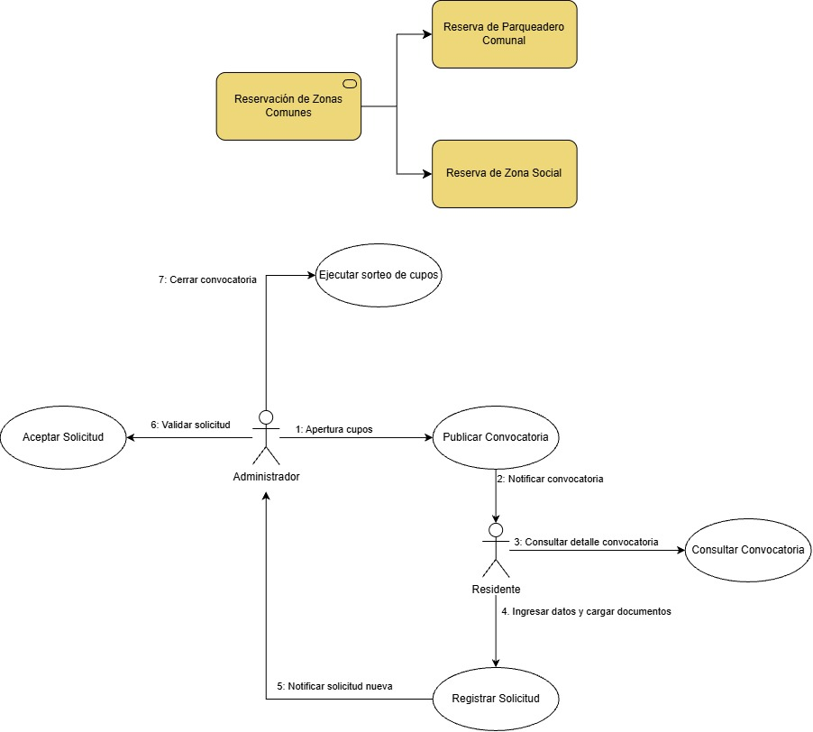

# Escenarios de servicio

> **Propósito:** describir cómo se realiza cada servicio de negocio y qué casos de uso (C.U) intervienen.
> **Fuente:** diagrama *Escenarios v2*.

## Catálogo
| ID | Escenario de servicio | Servicio de negocio | Estado |
|----|-----------------------|---------------------|--------|
| ESN-01 | Reserva de parqueadero comunal | [SN-06](05-servicios-de-negocio.md) Reservación de zonas comunes | 🟡 En construcción |
| ESN-02 | Reserva de zona social | [SN-06](05-servicios-de-negocio.md) Reservación de zonas comunes | ✏️ |

## ESN-01 · Reserva de parqueadero comunal
El escenario se repite en cada convocatoria, con la periodicidad y los cupos que defina el conjunto (SUP-02, SUP-03).

| Paso | Actor | Acción | Caso de uso |
|:----:|-------|--------|-------------|
| 1 | Administrador | Apertura de cupos | [C.U-01 Publicar convocatoria](../02-modelo-de-capacidades/casos-de-uso/C.U-01-publicar-convocatoria.md) |
| 2 | Sistema → Residente | Notificar convocatoria | [MEC-05 Notificación de eventos de convocatoria](../03-modelo-de-arquitectura/03-mecanismos-de-diseno/README.md) |
| 3 | Residente | Consultar detalle de la convocatoria | [C.U-02 Consultar convocatoria](../02-modelo-de-capacidades/casos-de-uso/C.U-02-consultar-convocatoria.md) |
| 4 | Residente | Ingresar datos y cargar documentos | [C.U-03 Registrar solicitud](../02-modelo-de-capacidades/casos-de-uso/C.U-03-registrar-solicitud.md) |
| 5 | Sistema → Administrador | Notificar solicitud nueva | [MEC-05 Notificación de eventos de convocatoria](../03-modelo-de-arquitectura/03-mecanismos-de-diseno/README.md) |
| 6 | Administrador | Validar solicitud | [C.U-07 Aceptar solicitud](../02-modelo-de-capacidades/casos-de-uso/C.U-07-aceptar-solicitud.md) |
| 7 | Administrador | Cerrar convocatoria | [C.U-08 Ejecutar sorteo de cupos](../02-modelo-de-capacidades/casos-de-uso/C.U-08-ejecutar-sorteo-de-cupos.md) |

## ESN-02 · Reserva de zona social
✏️ **Por completar:** pasos, actores y casos de uso.
