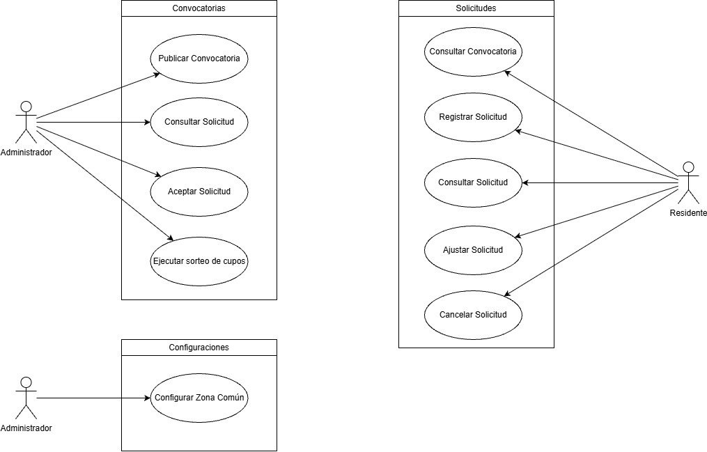

# Mapa de casos de uso (C.U)

> **Propósito:** organizar las capacidades del sistema por paquete y actor, y trazarlas a los escenarios de servicio y a los requisitos implementados.
> **Fuente:** diagrama *Casos de Uso v2*. Plantilla: [caso-de-uso](../plantillas/caso-de-uso.md).

## Inventario
| ID | Caso de uso | Paquete | Actor | Escenario de servicio | RF relacionados | Estado |
|----|-------------|---------|-------|-----------------------|-----------------|--------|
| [C.U-01](casos-de-uso/C.U-01-publicar-convocatoria.md) | Publicar convocatoria | Convocatorias | Administrador | ESN-01 · paso 1 | RF-10 | 🔴 No implementado |
| [C.U-02](casos-de-uso/C.U-02-consultar-convocatoria.md) | Consultar convocatoria | Solicitudes | Residente | ESN-01 · paso 3 | RF-02, RF-03 | 🟢 Implementado |
| [C.U-03](casos-de-uso/C.U-03-registrar-solicitud.md) | Registrar solicitud | Solicitudes | Residente | ESN-01 · paso 4 | RF-04, RF-05, RF-06, RF-07 | 🟡 Implementado parcialmente |
| [C.U-04](casos-de-uso/C.U-04-consultar-solicitud.md) | Consultar solicitud | Solicitudes · Convocatorias | Residente, Administrador | — | RF-08, RF-09 (Residente) | 🟡 Implementado para Residente |
| [C.U-05](casos-de-uso/C.U-05-ajustar-solicitud.md) | Ajustar solicitud | Solicitudes | Residente | — | — | 🔴 No implementado |
| [C.U-06](casos-de-uso/C.U-06-cancelar-solicitud.md) | Cancelar solicitud | Solicitudes | Residente | — | — | 🔴 No implementado |
| [C.U-07](casos-de-uso/C.U-07-aceptar-solicitud.md) | Aceptar solicitud | Convocatorias | Administrador | ESN-01 · paso 6 | — | 🔴 No implementado |
| [C.U-08](casos-de-uso/C.U-08-ejecutar-sorteo-de-cupos.md) | Ejecutar sorteo de cupos | Convocatorias | Administrador | ESN-01 · paso 7 | — | 🔴 No implementado |
| [C.U-09](casos-de-uso/C.U-09-configurar-zona-comun.md) | Configurar zona común | Configuraciones | Administrador | — | — | 🔴 No implementado |

## Capacidades transversales
| Capacidad | Tratamiento | Referencia |
|-----------|-------------|------------|
| Iniciar sesión (RF-01) | No figura en el diagrama de C.U; se trata como precondición de los C.U y como mecanismo de autenticación | [EUV-01](../04-modelo-de-validacion/euv/EUV-01-iniciar-sesion.md), [MEC-01](../03-modelo-de-arquitectura/03-mecanismos-de-diseno/README.md) |
| Notificaciones (ESN-01, pasos 2 y 5) | No es un C.U porque no corresponde a un objetivo de un actor; se trata como mecanismo de diseño | [MEC-05](../03-modelo-de-arquitectura/03-mecanismos-de-diseno/README.md) |

> **Terminología:** la documentación usa **Solicitud** (modelo semántico); la implementación v1 la denomina **Solicitud** (`Application`). Ver [Modelo semántico](../01-modelo-de-negocio/03-modelo-semantico.md#alineación-de-términos-con-la-implementación).
