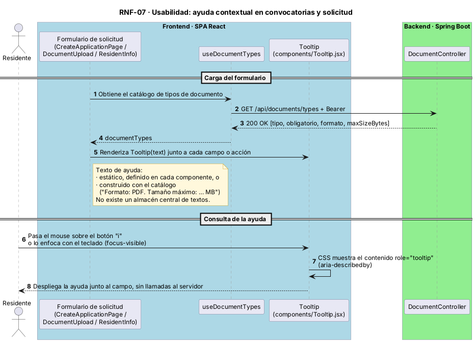

# Atributos de calidad y requerimientos no funcionales (RNF)

> **Herramienta de identificación:** plantilla RNF ISO/IEC 25010 del equipo (archivo de trabajo, no publicado en la wiki). Plantilla de página: [rnf](../plantillas/rnf.md). Cada RNF que requiera una decisión estructural origina un [mecanismo de diseño](../03-modelo-de-arquitectura/03-mecanismos-de-diseno/README.md).

| ID | Atributo | Requisito | Medida | Escenario | Evidencia |
|----|----------|-----------|--------|-----------|-----------|
| RNF-01 | Rendimiento | Soportar ráfagas de solicitudes al abrir una convocatoria | p95 < 2000 ms y errores < 1 % con 300 usuarios virtuales | [EUV-Q-01](../04-modelo-de-validacion/euv/EUV-Q-01-concurrencia-postulaciones.md) | Resultados k6 |
| RNF-02 | Seguridad | Todo endpoint de negocio exige un JWT válido | 100 % de rechazo sin token (401) | [EUV-Q-02](../04-modelo-de-validacion/euv/EUV-Q-02-acceso-no-autenticado.md) | `SecurityConfig` |
| RNF-03 | Integridad | Una sola solicitud por unidad privada y convocatoria, incluso con concurrencia | 0 duplicados | [EUV-Q-03](../04-modelo-de-validacion/euv/EUV-Q-03-postulacion-duplicada.md) | Restricción única en BD |
| RNF-04 | Desplegabilidad | Despliegue automatizado con verificación de salud | Despliegue sin intervención; falla si `/api/health` no responde | [EUV-Q-04](../04-modelo-de-validacion/euv/EUV-Q-04-despliegue-automatizado.md) | `appspec.yml` |
| RNF-05 | Escalabilidad / eficiencia | Los archivos no pasan por el backend | 0 bytes de archivo procesados por la API | [EUV-Q-05](../04-modelo-de-validacion/euv/EUV-Q-05-carga-documentos-s3.md) | [ADR-0004](../03-modelo-de-arquitectura/04-decisiones-adr/ADR-0004-carga-directa-a-s3.md) |
| RNF-06 | Mantenibilidad | Frontend organizado por *features* con capas (domain / application / infrastructure / presentation) | Dependencias solo hacia el dominio | — | [ADR-0002](../03-modelo-de-arquitectura/04-decisiones-adr/ADR-0002-frontend-clean-architecture-por-features.md) |
| RNF-07 | Usabilidad | Ayuda contextual junto a los campos y acciones de convocatoria y solicitud | ✏️ | — | Componente `Tooltip` ([diagrama](#diagramas-de-secuencia-de-rnf)) |
| RNF-08 | Disponibilidad | El servicio opera 20 horas al día, los 7 días de la semana (20/7); no se exige operación 24/7 | Servicio disponible durante la franja diaria de 20 h (✏️ definir horario de la franja) | ✏️ EUV por crear | [ADR-0007](../03-modelo-de-arquitectura/04-decisiones-adr/ADR-0007-despliegue-in-place-ec2-persistente.md) |

## Diagramas de secuencia de RNF
Diagramas alineados con el desarrollo actual (backend `develop`, frontend `main`). Fuentes PlantUML en `assets/diagramas/`.

| RNF | Diagrama | EUV |
|-----|----------|-----|
| RNF-02 Seguridad | [Autenticación JWT sin estado](../assets/imagenes/rnf-02-autenticacion-jwt.png) | [EUV-Q-02](../04-modelo-de-validacion/euv/EUV-Q-02-acceso-no-autenticado.md) |
| RNF-03 Integridad | [Una solicitud por unidad privada y convocatoria](../assets/imagenes/rnf-03-unicidad-solicitud.png) | [EUV-Q-03](../04-modelo-de-validacion/euv/EUV-Q-03-postulacion-duplicada.md) |
| RNF-04 Desplegabilidad | [Despliegue in-place verificado](../assets/imagenes/rnf-04-despliegue-in-place.png) | [EUV-Q-04](../04-modelo-de-validacion/euv/EUV-Q-04-despliegue-automatizado.md) |
| RNF-05 Escalabilidad | [Carga directa de documentos a S3](../assets/imagenes/rnf-05-carga-directa-s3.png) | [EUV-Q-05](../04-modelo-de-validacion/euv/EUV-Q-05-carga-documentos-s3.md) |
| RNF-07 Usabilidad | [Ayuda contextual](../assets/imagenes/rnf-07-ayuda-contextual.png) | ✏️ EUV por crear |

### RNF-07 · Ayuda contextual

## Priorización (árbol de utilidad)
Importancia para el negocio (H/M/L) · dificultad técnica (H/M/L).

| Atributo | Refinamiento | Escenario | Prioridad |
|----------|--------------|-----------|-----------|
| Rendimiento | Latencia bajo pico | EUV-Q-01 | (H, H) |
| Integridad | Unicidad de solicitud | EUV-Q-03 | (H, M) |
| Seguridad | Autenticación | EUV-Q-02 | (H, M) |
| Desplegabilidad | Pipeline automático | EUV-Q-04 | (M, M) |
| Escalabilidad | Carga de archivos | EUV-Q-05 | (M, M) |
| Disponibilidad | Operación 20/7 | ✏️ | ✏️ |
