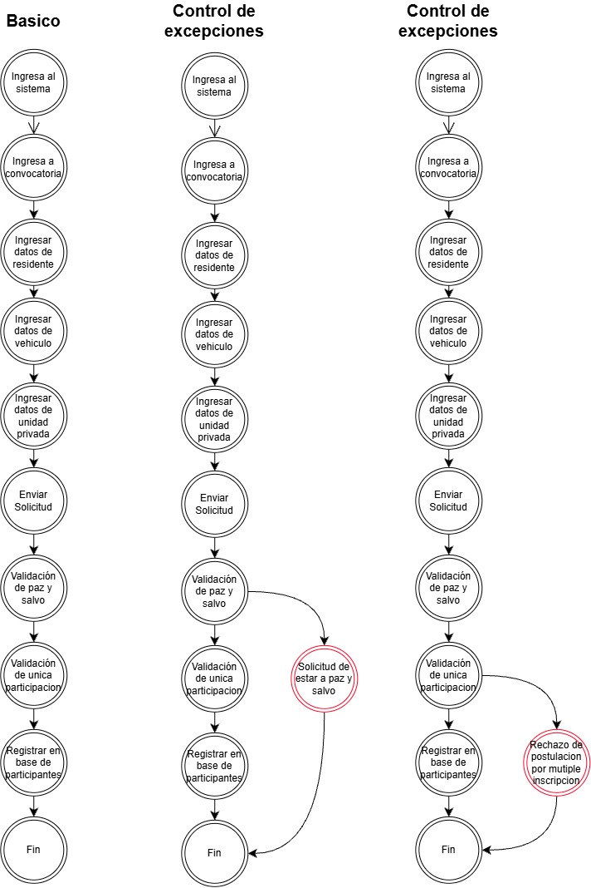

# C.U-03 · Registrar solicitud

| Campo | Valor |
|-------|-------|
| Paquete | Solicitudes |
| Actor primario | Residente |
| Actores secundarios | AWS S3 (almacenamiento de documentos) |
| Servicio de negocio | [SN-06](../../01-modelo-de-negocio/05-servicios-de-negocio.md) Reservación de zonas comunes |
| Escenario de servicio | ESN-01 · paso 4 |
| Objetivo del actor | Presentar una solicitud a la convocatoria de parqueadero comunal para participar en la asignación de cupos |
| Resultado observable | Solicitud registrada en la base de participantes, con número único y estado `PENDING_VALIDATION` |
| Requisitos funcionales relacionados | RF-04, RF-05, RF-06, RF-07 |
| Estado | 🟡 Implementado parcialmente (ver columna *Estado v1*) |

> **Fuente de los flujos:** diagrama *Flujos de Postulación* del equipo (flujo básico y dos flujos de control de excepciones). Los flujos alternativos y las excepciones FE-03 a FE-10 se identificaron en la implementación v1. La columna *Estado v1* compara cada paso con el código de la rama `fix/integracion-aprobacion-sorteo` (revisión 2026-11-09).
>
> **Decisión del equipo:** por ahora no se piden los datos del vehículo (paso *Ingresar datos de vehículo* del diagrama); solo se cargan sus documentos.

## Precondiciones
1. El residente inició sesión con `ROLE_RESIDENT` ([EUV-01](../../04-modelo-de-validacion/euv/EUV-01-iniciar-sesion.md)). El administrador no tiene acceso a las opciones del residente ([RN-40](../../01-modelo-de-negocio/04-reglas-de-negocio.md)).
2. Existe una convocatoria abierta ([C.U-02](C.U-02-consultar-convocatoria.md)).
3. El residente tiene una unidad privada asociada.

## Postcondiciones
1. La solicitud queda registrada en estado `PENDING_VALIDATION`, con fecha de creación (zona America/Bogota) y un número legible y consecutivo por convocatoria, con formato `POS-{convocatoria}-{consecutivo}` (por ejemplo, `POS-1-0001`). El número es único ([RN-39](../../01-modelo-de-negocio/04-reglas-de-negocio.md)).
2. Los documentos cargados quedan vinculados a la solicitud.
3. La unidad privada no puede registrar otra solicitud en la misma convocatoria.

## Flujo básico
| Paso | Actor / Sistema | Acción | Estado v1 |
|:----:|-----------------|--------|-----------|
| 1 | Residente | Ingresa al sistema | 🟢 Inicio de sesión con JWT |
| 2 | Residente | Ingresa a la convocatoria y elige presentar una solicitud | 🟢 La opción solo está habilitada si la convocatoria está abierta (estado derivado `OPEN`); antes de abrir el formulario el frontend verifica la elegibilidad (`GET /api/applications/check`) |
| 3 | Residente | Confirma sus datos de residente | 🟡 Nombre y unidad privada (apartamento y torre) se toman de la sesión del residente autenticado (respuesta del login). El estado de cuenta (*Paz y Salvo*) se muestra fijo porque el backend no lo expone (RN-16) |
| 4 | Residente | Carga los documentos del vehículo y del residente (licencia de tránsito, SOAT y licencia de conducción obligatorios; revisión técnico-mecánica y soporte de tenencia opcionales) | 🟢 Carga directa a S3 ([RNF-05](../03-atributos-de-calidad-y-rnf.md#diagramas-de-secuencia-de-rnf)); catálogo en `GET /api/documents/types` |
| 5 | Residente | Ingresa los datos de la unidad privada | 🟡 La unidad se toma del residente autenticado; no se ingresa |
| 6 | Residente | Envía la solicitud | 🟢 `POST /api/applications`. El botón se habilita cuando están cargados todos los documentos obligatorios |
| 7 | Sistema | Valida que el residente esté a paz y salvo con la administración | 🔴 No implementado ([RN-16](../../01-modelo-de-negocio/04-reglas-de-negocio.md#reglas-identificadas-por-implementar)) |
| 8 | Sistema | Valida que la unidad privada tenga una única participación en la convocatoria | 🟢 [RN-04](../../01-modelo-de-negocio/04-reglas-de-negocio.md). La validación y el registro se hacen con la convocatoria bloqueada (lock pesimista), así que las solicitudes simultáneas a la misma convocatoria se procesan una a la vez |
| 9 | Sistema | Valida los documentos (existen, cargados y obligatorios completos), asigna el número consecutivo y registra la solicitud en la base de participantes | 🟢 [RN-05 a RN-07, RN-13, RN-39](../../01-modelo-de-negocio/04-reglas-de-negocio.md) |
| 10 | Sistema | Muestra la confirmación con el número de la solicitud, el residente, la unidad privada y los documentos adjuntos. Fin | 🟢 `ApplicationSummary` |

## Flujos alternativos
> ⚠️ **Por confirmar con Negocio:** identificados en la implementación v1; el diagrama de flujos no incluye flujos alternativos.

| Código | Paso de origen | Condición | Acción | Retorno |
|--------|:--------------:|-----------|--------|---------|
| FA-01 | 4 | El vehículo no está a nombre del residente | El residente adjunta además el soporte de tenencia (documento opcional del catálogo) | Paso 4 |
| FA-02 | 4 | El residente desea reemplazar un documento ya cargado | Selecciona un nuevo archivo para el mismo tipo; el sistema reemplaza la carga anterior | Paso 4 |
| FA-03 | 4 | El residente desea revisar sus datos antes de enviar | Regresa al paso anterior del formulario (botón *Atrás*) | Paso 3 |

## Flujos de excepción
| Código | Paso | Condición | Respuesta del sistema | Regla | Estado v1 |
|--------|:----:|-----------|-----------------------|-------|-----------|
| FE-01 | 7 | El residente no está a paz y salvo | Rechaza la solicitud e informa que debe estar a paz y salvo. Fin | [RN-16](../../01-modelo-de-negocio/04-reglas-de-negocio.md#reglas-identificadas-por-implementar) | 🔴 No implementado |
| FE-02 | 8 | La unidad privada ya tiene una solicitud vigente (`PENDING_VALIDATION` o `APPROVED`) en la convocatoria, aunque la haya registrado otro residente de la misma unidad | Rechaza la solicitud por múltiple inscripción (`409 APPLICATION_ALREADY_EXISTS`). Fin | [RN-04](../../01-modelo-de-negocio/04-reglas-de-negocio.md) | 🟢 Las solicitudes simultáneas se serializan con el bloqueo de la convocatoria, así que no quedan duplicadas aunque no haya restricción única en BD ([R-09](../../06-direccion-y-planeacion/05-riesgos-y-deuda-tecnica.md), mitigado) |
| FE-03 | 2 | La convocatoria no está abierta (`SCHEDULED` o `CLOSED`) | No habilita la solicitud. Si la solicitud llega al backend, la rechaza (`409 CALL_CLOSED`). Fin | [RN-25, RN-29](../../01-modelo-de-negocio/04-reglas-de-negocio.md) | 🟢 Los cupos no limitan el registro de solicitudes ([modelo de cupos](../../01-modelo-de-negocio/04-reglas-de-negocio.md#modelo-de-cupos)) |
| FE-04 | 6 | La convocatoria no existe | Rechaza la solicitud (`404`, sin cuerpo). Fin | [RN-01](../../01-modelo-de-negocio/04-reglas-de-negocio.md) | 🟢 |
| FE-05 | 6 | El residente no tiene unidad privada asociada (`400 APARTMENT_NOT_FOUND`) | Rechaza la solicitud. Fin | [RN-03](../../01-modelo-de-negocio/04-reglas-de-negocio.md) | 🟢 |
| FE-06 | 4 | El archivo no es PDF (`400 INVALID_CONTENT_TYPE`) | Rechaza el archivo | [RN-08](../../01-modelo-de-negocio/04-reglas-de-negocio.md) | 🟢 El frontend lo valida antes de subirlo y el backend al pedir la URL de carga |
| FE-07 | 4 | El archivo supera 2 MB (`400 FILE_TOO_LARGE`) | Rechaza el archivo | [RN-09](../../01-modelo-de-negocio/04-reglas-de-negocio.md) | 🟢 Validado en el frontend y en el backend |
| FE-08 | 4 | El archivo no se encuentra en S3 al confirmar la carga (`404 FILE_NOT_FOUND_IN_S3`) | Rechaza la confirmación; el frontend muestra la carga como fallida | [RN-11](../../01-modelo-de-negocio/04-reglas-de-negocio.md) | 🟡 El documento queda en estado `PENDING` en BD: el estado `FAILED` existe en el modelo pero no se asigna |
| FE-08a | 4 | El tipo de documento no pertenece al catálogo (`400 INVALID_DOCUMENT_TYPE`) | Rechaza la carga | [RN-07](../../01-modelo-de-negocio/04-reglas-de-negocio.md) | 🟢 |
| FE-09 | 9 | Un documento no existe (`400 DOCUMENT_NOT_FOUND`) o no terminó de cargarse (`400 DOCUMENT_NOT_UPLOADED`) | Rechaza la solicitud | [RN-06](../../01-modelo-de-negocio/04-reglas-de-negocio.md) | 🟢 |
| FE-10 | 9 | Faltan documentos obligatorios (`400 REQUIRED_DOCUMENTS_MISSING`) | Rechaza la solicitud indicando los documentos faltantes | [RN-07](../../01-modelo-de-negocio/04-reglas-de-negocio.md) | 🟢 |

En FE-06 a FE-10 el residente puede corregir y volver al paso 4; FE-01 a FE-05 terminan el caso de uso.

## Reglas de negocio aplicables
RN-01, RN-03 a RN-13, RN-16 y RN-39 ([Reglas de negocio](../../01-modelo-de-negocio/04-reglas-de-negocio.md)).

## RNF aplicables
| RNF | Aplicación en este C.U |
|-----|------------------------|
| RNF-01 Rendimiento | Pico de solicitudes al abrir la convocatoria |
| RNF-02 Seguridad | El residente se toma del JWT |
| RNF-03 Integridad | Una solicitud por unidad privada y convocatoria (FE-02) y número de solicitud sin repetir, ambos garantizados por el bloqueo de la convocatoria |
| RNF-05 Escalabilidad | Carga directa de documentos a S3 (paso 4) |

## EUV asociados
| EUV | Flujo que demuestra | Estado |
|-----|---------------------|--------|
| [EUV-03](../../04-modelo-de-validacion/euv/EUV-03-verificar-elegibilidad.md) | Verificación previa de única participación (paso 8, FE-02) | Implementado; el frontend la invoca desde el detalle de la convocatoria |
| [EUV-04](../../04-modelo-de-validacion/euv/EUV-04-cargar-documentos.md) | Paso 4, FA-02, FE-06 a FE-08 | Implementado |
| [EUV-05](../../04-modelo-de-validacion/euv/EUV-05-registrar-postulacion.md) | Flujo básico, FE-02, FE-04, FE-05, FE-09, FE-10 | Implementado |
| [EUV-Q-01](../../04-modelo-de-validacion/euv/EUV-Q-01-concurrencia-postulaciones.md) | Flujo básico bajo concurrencia | Implementado |
| [EUV-Q-03](../../04-modelo-de-validacion/euv/EUV-Q-03-postulacion-duplicada.md) | FE-02 ante solicitudes simultáneas | Implementado |
| [EUV-Q-05](../../04-modelo-de-validacion/euv/EUV-Q-05-carga-documentos-s3.md) | Paso 4 | Implementado |
| ✏️ EUV por crear | FE-01 paz y salvo | Pendiente |
