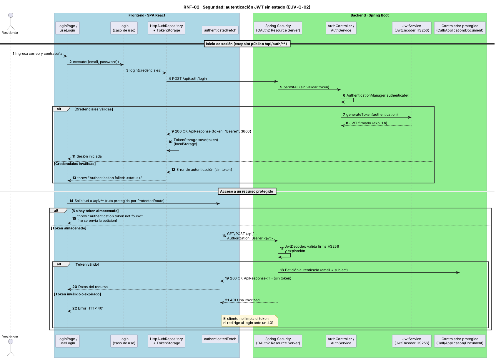

# EUV-Q-02 · Seguridad: acceso no autenticado a la API

| Parte del QAS | Descripción |
|---------------|-------------|
| **Fuente** | Cliente externo sin credenciales o con token expirado/alterado |
| **Estímulo** | Invoca un endpoint de negocio (`/api/calls`, `/api/applications`, `/api/documents/**`) |
| **Artefacto** | `SecurityFilterChain` (Spring Security, OAuth2 Resource Server) |
| **Entorno** | Operación normal |
| **Respuesta** | La solicitud se rechaza antes de llegar al controlador |
| **Medida** | 100 % de las solicitudes sin JWT válido reciben 401; 0 datos expuestos |

## Implementación
| Ruta | Acceso |
|------|--------|
| `/api/auth/**` | Público |
| `/api/health` | Público |
| `/swagger-ui/**`, `/v3/api-docs/**` | Público |
| `/h2-console/**` | Público ⚠️ (ver R-02) |
| Cualquier otra | Requiere JWT HS256 válido (`iss = adminv1`, expira en 1 h) |

### Diagrama de secuencia (RNF-02)

Fuente: `assets/diagramas/rnf-02-autenticacion-jwt.puml`.

## Pendientes
- ✏️ Prueba automatizada que valide el 401 (añadir a `api-tests/test_api.py`); la prueba de extremo a extremo solo cubre accesos con token válido.
- ⚠️ La autorización por rol (`ROLE_ADMIN` / `ROLE_RESIDENT`) no se aplica en los endpoints.
