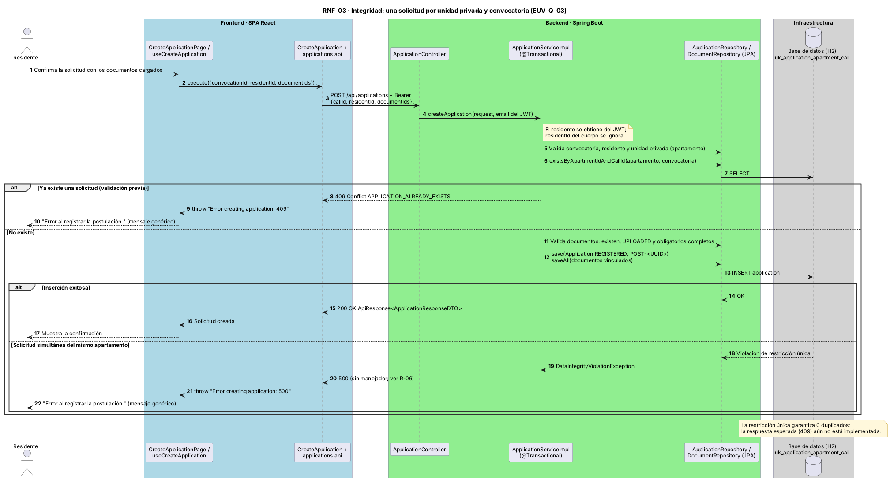

# EUV-Q-03 · Integridad: solicitud duplicada de la misma unidad privada

| Parte del QAS | Descripción |
|---------------|-------------|
| **Fuente** | Dos residentes de la misma unidad privada (o doble clic del mismo residente) |
| **Estímulo** | Envían `POST /api/applications` para la misma convocatoria, incluso simultáneamente |
| **Artefacto** | `ApplicationServiceImpl` + tabla `applications` |
| **Entorno** | Operación normal con concurrencia |
| **Respuesta** | Solo una solicitud persiste; la otra recibe `409 APPLICATION_ALREADY_EXISTS` |
| **Medida** | 0 filas duplicadas `(apartment_id, call_id)` |

## Tácticas (defensa en dos niveles)
1. **Validación en el servicio:** consulta previa de existencia → 409 con un mensaje claro.
2. **Restricción en BD:** `uk_application_apartment_call (apartment_id, call_id)` → garantiza la unicidad aunque dos transacciones pasen la validación a la vez.

### Diagrama de secuencia (RNF-03)

Fuente: `assets/diagramas/rnf-03-unicidad-solicitud.puml`. Refleja el comportamiento actual: ante solicitudes simultáneas la API responde 500 en lugar de 409 ([R-06](../../06-direccion-y-planeacion/05-riesgos-y-deuda-tecnica.md)).

## Evidencias
- ✏️ Prueba que ejecute 2 solicitudes simultáneas con el misma unidad privada.
