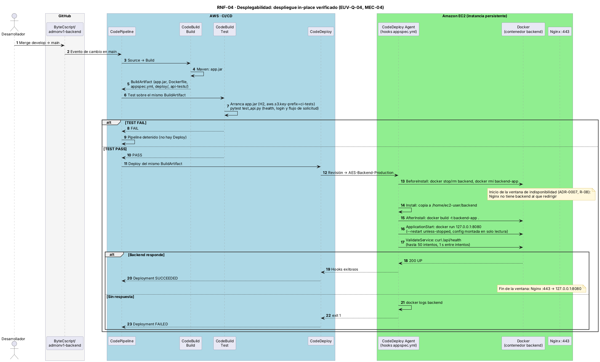

# EUV-Q-04 · Desplegabilidad: despliegue automatizado y verificado

| Parte del QAS | Descripción |
|---------------|-------------|
| **Fuente** | Desarrollador |
| **Estímulo** | Integra cambios de `develop` en `main`, rama que dispara el pipeline |
| **Artefacto** | AWS CodePipeline → CodeBuild Build (BuildArtifact) → CodeBuild Test (pruebas API) → CodeDeploy (EC2 + Docker) |
| **Entorno** | Producción / nube AWS |
| **Respuesta** | Se compila una vez, se prueba ese mismo JAR, solo con PASS se reemplaza el contenedor y se valida la salud |
| **Medida** | 0 pasos manuales; una prueba fallida detiene el pipeline; el despliegue falla si `/api/health` no responde tras 50 intentos (1 s de pausa; límite del hook: 60 s) |

Detalle del pipeline: [02-pipeline-ci-cd](../../07-codigo-y-despliegue/02-pipeline-ci-cd.md).

## Diagrama de secuencia (RNF-04)

Fuente: `assets/diagramas/rnf-04-despliegue-in-place.puml`.

## Pendientes
- ✏️ Tiempo total medido del pipeline.
- ✏️ Estrategia de rollback (CodeDeploy *in-place*, [ADR-0007](../../03-modelo-de-arquitectura/04-decisiones-adr/ADR-0007-despliegue-in-place-ec2-persistente.md)): confirmar si hay reversión automática.

Mecanismo verificado: [MEC-04](../../03-modelo-de-arquitectura/03-mecanismos-de-diseno/MEC-04-despliegue-automatizado-verificado.md).
