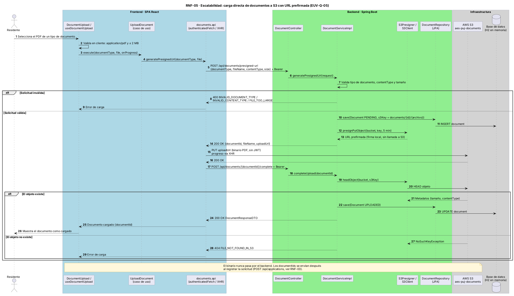

# EUV-Q-05 · Escalabilidad: carga de archivos sin pasar por la API

| Parte del QAS | Descripción |
|---------------|-------------|
| **Fuente** | Muchos residentes |
| **Estímulo** | Cargan documentos PDF (hasta 2 MB cada uno, 5 tipos) durante una convocatoria |
| **Artefacto** | Backend API y AWS S3 |
| **Entorno** | Pico de carga |
| **Respuesta** | El archivo viaja directo del navegador a S3; la API solo emite la URL prefirmada y confirma |
| **Medida** | 0 bytes de archivo procesados por la API; la memoria y el ancho de banda del backend no dependen del tamaño del archivo |

Decisión: [ADR-0004](../../03-modelo-de-arquitectura/04-decisiones-adr/ADR-0004-carga-directa-a-s3.md). Flujo: [EUV-04](EUV-04-cargar-documentos.md).

## Diagrama de secuencia (RNF-05)

Fuente: `assets/diagramas/rnf-05-carga-directa-s3.puml`.

## Pendientes
- ⚠️ Confirmar la política CORS del bucket S3 para el `PUT` desde el navegador; la prueba de extremo a extremo hace el `PUT` desde Python y no la valida.
- ✏️ Limpieza de documentos `PENDING` huérfanos.
