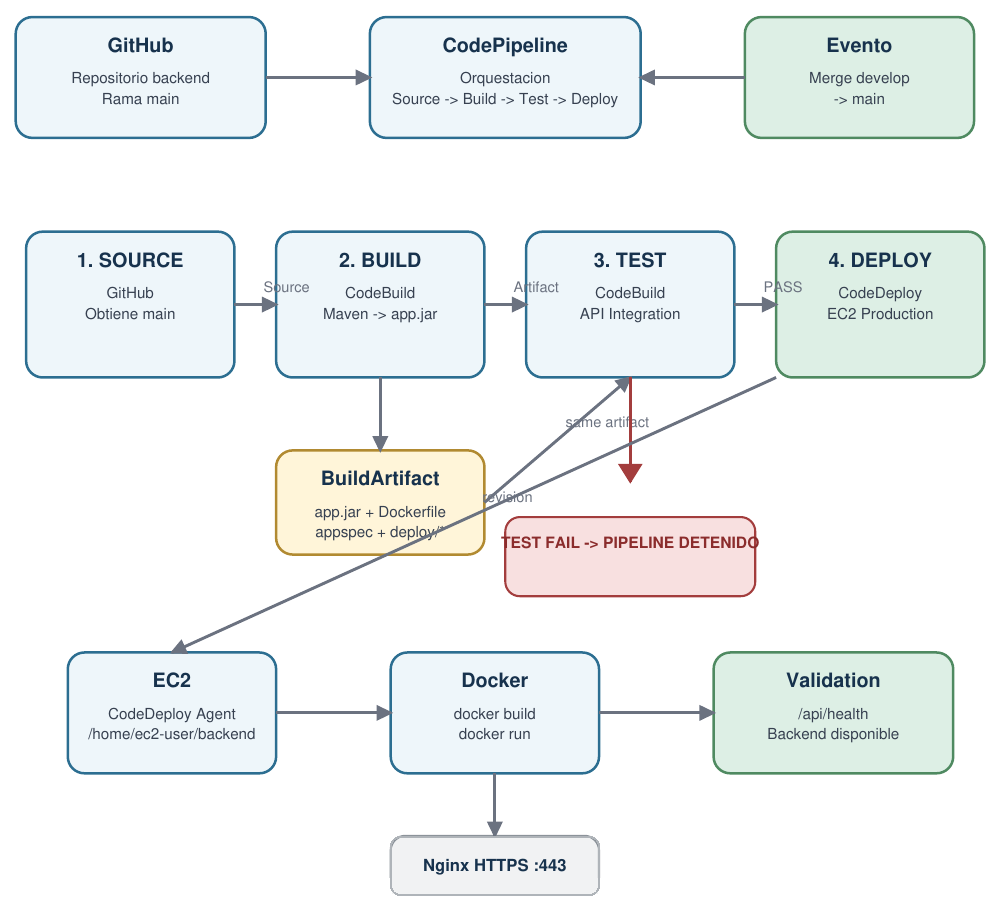

# Pipeline CI/CD

> **Propósito:** documentar cómo una integración de código del backend llega de GitHub a producción, pasando por construcción, pruebas y despliegue automatizado.
> **Fuente:** documento de modelado de la solución *Pipeline CI/CD AWS* elaborado por el equipo.

**Principio central:** construir una sola vez, validar esa misma versión y promoverla a producción solo cuando las pruebas sean exitosas.

## Configuración actual
| Elemento | Configuración |
|----------|---------------|
| Fuente | GitHub · `ByteCscript/admonv1-backend` |
| Rama de liberación | `main` (integración desde `develop`, ver [GitFlow](01-gitflow.md)) |
| Orquestador | AWS CodePipeline |
| Build | AWS CodeBuild · `AES-Backend-Build` |
| Test | AWS CodeBuild · pruebas de integración API |
| Deploy | AWS CodeDeploy · `AES-Backend-Production` |
| Runtime | Amazon EC2 + Docker |
| Entrada pública | Nginx HTTPS :443 ([ADR-0008](../03-modelo-de-arquitectura/04-decisiones-adr/ADR-0008-nginx-punto-unico-de-entrada-https.md)) |

## Diagrama general

**Lectura del diagrama:** GitHub entrega el cambio a CodePipeline; Build produce el artefacto; Test ejecuta validaciones sobre el mismo artefacto; solo un resultado PASS habilita Deploy; CodeDeploy actualiza la instancia EC2 y finalmente se valida `/api/health`.

## Flujo de ejecución
| Etapa | Servicio | Qué ocurre |
|-------|----------|------------|
| Integración | GitHub | El desarrollo ocurre en `develop`; el merge hacia `main` marca la versión candidata a producción. El pipeline se activa por cambios en `main`, no por la creación de un Pull Request |
| Source | GitHub + CodePipeline | CodePipeline obtiene el código de `main`; GitHub es la fuente de verdad del código |
| Build | CodeBuild | Maven genera `app.jar` y se empaqueta el **BuildArtifact**: `app.jar`, `Dockerfile`, `appspec.yml`, scripts `deploy/` y archivos de prueba |
| Test | CodeBuild | Levanta el mismo `app.jar` en un entorno temporal y ejecuta las pruebas de integración API. Si una prueba falla, el pipeline se detiene |
| Deploy | CodeDeploy | El grupo `AES-Backend-Production` apunta a la instancia EC2 existente y ejecuta los hooks de `appspec.yml` |

## El papel del BuildArtifact
`Código → Build → app.jar → BuildArtifact → Test → Deploy`

El backend no se recompila después de probarlo. La unidad que supera la barrera de calidad es exactamente la que se despliega, lo que evita que una segunda compilación produzca una versión distinta entre pruebas y producción ([MEC-04](../03-modelo-de-arquitectura/03-mecanismos-de-diseno/MEC-04-despliegue-automatizado-verificado.md)).

## Etapas y archivos
| Etapa | Archivo | Entorno | Salida |
|-------|---------|---------|--------|
| Build | `buildspec.yml` | Corretto 21, Maven | `app.jar`, `Dockerfile`, `appspec.yml`, `deploy/`, `api-tests/`, `buildspec-api-test.yml` |
| Test | `buildspec-api-test.yml` | Corretto 21, Python 3.10 | Reporte de pytest, log del backend |
| Deploy | `appspec.yml` + `deploy/*.sh` | EC2, Docker | Contenedor `backend` en ejecución |

## Pruebas de integración API (etapa Test)
La etapa Test no ejecuta Selenium ni pruebas de navegador; valida el comportamiento de las APIs antes de tocar producción. La prueba de extremo a extremo de 8 pasos (`test_create_application_end_to_end`) y su relación con los EUV está en [Automatización de EUV](../04-modelo-de-validacion/04-automatizacion-de-euv.md#flujo-de-integración-del-pipeline).

**Regla de control:** `TEST PASS → DEPLOY` · `TEST FAIL → PIPELINE DETENIDO`.

## Despliegue con CodeDeploy
| Hook | Función |
|------|---------|
| `BeforeInstall` | Detiene y elimina el contenedor `backend` anterior y, cuando corresponde, la imagen anterior |
| Install | CodeDeploy copia el contenido del artefacto a `/home/ec2-user/backend` |
| `AfterInstall` | Construye la imagen Docker: `docker build -t backend-app .` |
| `ApplicationStart` | Inicia el contenedor en `127.0.0.1:8080` con `--restart unless-stopped` |
| `ValidateService` | Consulta `/api/health` hasta 50 intentos con 1 s de pausa, dentro del límite de 60 s del hook en `appspec.yml` |

La validación posterior al arranque evita considerar exitoso un despliegue solo porque Docker ejecutó el comando de inicio. La estrategia es *in-place* sobre la instancia existente ([ADR-0007](../03-modelo-de-arquitectura/04-decisiones-adr/ADR-0007-despliegue-in-place-ec2-persistente.md)).

## Matriz de responsabilidades y controles
| Etapa | Servicio | Acción | Condición de avance | Fallo |
|-------|----------|--------|---------------------|-------|
| Source | GitHub + CodePipeline | Obtener `main` | Código disponible | Pipeline detenido |
| Build | CodeBuild | Compilar y empaquetar | `app.jar` generado | No se genera el artefacto |
| Test | CodeBuild | Ejecutar pruebas API | Todas las pruebas PASS | No se permite Deploy |
| Deploy | CodeDeploy | Actualizar EC2 | Hooks exitosos | Deployment FAILED |
| Start | Docker + CodeDeploy | Levantar el backend | Contenedor iniciado | Deployment FAILED |
| Validation | CodeDeploy | Consultar `/api/health` | El backend responde | Deployment FAILED |
| Runtime | EC2 + Docker | Ejecutar la aplicación | Contenedor activo | Servicio no disponible |

Cada etapa tiene un responsable técnico distinto, lo que permite ubicar dónde se produjo un problema: repositorio, compilación, pruebas, despliegue o arranque.

## Catálogo de componentes
| Componente | Tipo | Responsabilidad | Entrada / salida |
|------------|------|-----------------|------------------|
| GitHub | Repositorio | Almacenar el código fuente | Cambios / commit en `main` |
| CodePipeline | Orquestador | Coordinar Source, Build, Test y Deploy | Evento de `main` / ejecución |
| CodeBuild – Build | CI | Compilar y empaquetar | Código / BuildArtifact |
| BuildArtifact | Artefacto | Transportar una versión construida entre etapas | Build / Test y Deploy |
| CodeBuild – Test | QA / CI | Ejecutar pruebas API | BuildArtifact / PASS o FAIL |
| CodeDeploy | CD | Automatizar el despliegue sobre EC2 | BuildArtifact / nueva revisión |
| CodeDeploy Agent | Agente EC2 | Ejecutar los lifecycle hooks | Revisión / scripts ejecutados |
| Amazon EC2 | Cómputo | Ejecutar el backend productivo | Imagen Docker / servicio |
| Docker | Runtime | Empaquetar y ejecutar Spring Boot | `app.jar` + `Dockerfile` / contenedor |
| Nginx | Proxy inverso | Terminar HTTPS y dirigir el tráfico | Internet / backend local |
| CloudWatch Logs | Observabilidad | Registrar las ejecuciones de CodeBuild | Logs / trazabilidad |
| IAM | Seguridad | Controlar permisos entre servicios | Roles y políticas / acceso autorizado |

## Decisiones relacionadas
| Decisión | Registro |
|----------|----------|
| CodePipeline + CodeBuild + CodeDeploy con Docker en EC2 | [ADR-0006](../03-modelo-de-arquitectura/04-decisiones-adr/ADR-0006-cicd-aws-docker-ec2.md) |
| Despliegue *in-place* sobre una única EC2 persistente | [ADR-0007](../03-modelo-de-arquitectura/04-decisiones-adr/ADR-0007-despliegue-in-place-ec2-persistente.md) |
| Nginx como punto único de entrada HTTPS | [ADR-0008](../03-modelo-de-arquitectura/04-decisiones-adr/ADR-0008-nginx-punto-unico-de-entrada-https.md) |

## Variables y secretos
| Nombre | Dónde | Uso |
|--------|-------|-----|
| `JWT_SECRET` | CodeBuild (variable del stage Test) | Firma JWT en las pruebas |
| `aws.s3.key-prefix=ci-tests/` | CodeBuild (variable del stage Test) | Aísla los objetos de prueba en S3 ([MEC-06](../03-modelo-de-arquitectura/03-mecanismos-de-diseno/README.md)) |
| `application.properties` | EC2 `/home/ec2-user/backend/config/` | Configuración de producción |

## Resumen para sustentación
> El desarrollo se realiza en `develop` y la integración hacia `main` marca una versión candidata a producción. CodePipeline orquesta el proceso: CodeBuild compila una sola vez y crea el BuildArtifact; luego otra etapa de CodeBuild prueba exactamente ese artefacto. Si las pruebas fallan, el pipeline se detiene. Si pasan, CodeDeploy toma ese mismo artefacto y actualiza la instancia EC2 mediante los lifecycle hooks de AppSpec. Finalmente, `ValidateService` confirma que el backend quedó disponible.

## Referencias técnicas
- [AWS CodePipeline – CodeBuild action reference](https://docs.aws.amazon.com/codepipeline/latest/userguide/action-reference-CodeBuild.html)
- [AWS CodeDeploy – Application Specification (AppSpec)](https://docs.aws.amazon.com/codedeploy/latest/userguide/application-specification-files.html)
- [AWS CodeDeploy – EC2 lifecycle event hooks](https://docs.aws.amazon.com/codedeploy/latest/userguide/reference-appspec-file-structure-hooks.html)

## Pipeline del frontend
✏️ **Por completar** — actualmente no hay archivos de CI/CD en `admonv1-frontend`. Documentar cómo se construye (`npm run build` → `dist/`) y dónde se publica.
